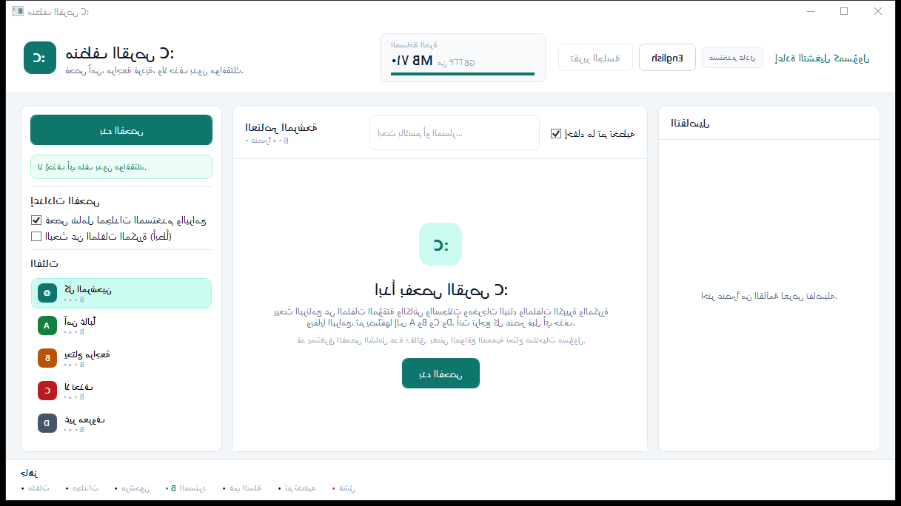
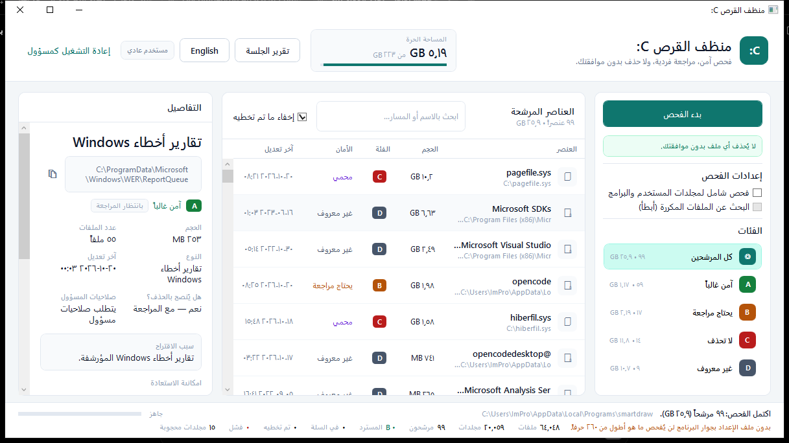
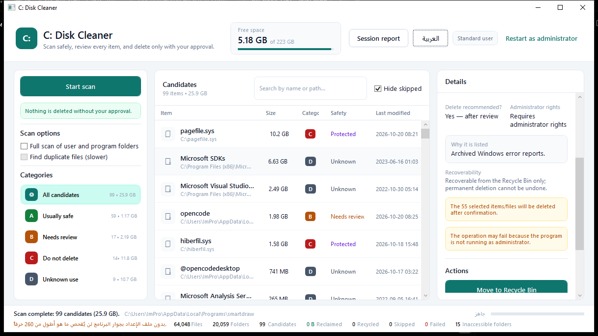

# CDiskCleaner

A **read-only-first** disk cleaner for drive `C:` on Windows. It scans, classifies and explains every
candidate before anything is deleted, then requires explicit **per-item approval** for every deletion.

WPF on **.NET Framework 4.8**, C#, **no NuGet dependencies**.



## Safety rules

These are hard rules in the code, not recommendations:

- **Nothing is deleted automatically.** Every deletion needs explicit approval.
- No automatic renaming, no moving, no registry changes, no uninstall.
- Every candidate is shown with full path, size, type, last modified time, reason, safety level,
  recoverability and the space it would reclaim.
- "The file is not currently in use" is **never** treated as a reason to delete.
- The deletion guard (`Services/PathSafety.cs`) refuses protected paths (`Windows`, `WinSxS`,
  `System32`, `Program Files` except recognized leftovers, drive roots, pagefile/hiberfil, ...).

## Classification

| Class | Meaning |
| --- | --- |
| **A** | Safe to delete (temp files, browser caches, thumbnails, crash dumps, old update cache, ...) |
| **B** | Needs review (old logs, ambiguous leftovers) |
| **C** | Must not delete (protected system items) |
| **D** | Unknown — always the user's decision |

Rows where `ScanItem.CanBeDeleted` is `false` can never be selected, including through *Select all*.

## Features

- Read-only scan of temp folders, browser caches, Windows Update cache, thumbnails, `INetCache`,
  crash dumps, WER reports, prefetch, Windows logs, plus a generic walk for build outputs
  (`bin`/`obj`/`target`/`node_modules`), installers, old logs, large files, duplicates (hashed)
  and program leftovers.
- Category filter, live search, "hide skipped", and the A/B/C/D counters.
- Row checkboxes plus a *Select all* header box that ticks only what is visible now and only what is
  deletable.
- Per-item choice: **Recycle Bin**, **permanent delete**, or **skip**.
- Bulk selection opens one confirmation dialog that lists every selected item; permanent delete stays
  disabled until an acknowledgement box is ticked.
- Deletion result and reclaimed space are reported per item; the report window summarizes space
  before / after / recovered, deleted count, skipped count and items still needing review.
- The report states that moving a file to the Recycle Bin does **not** free space.
- Arabic (RTL) and English (LTR) UI with instant switching, key-parity checked string tables.
- Long-path support (> 260 chars) through the app config switches, with a footer notice when the
  config file is missing next to the exe.




## Requirements

- Windows 10/11
- .NET Framework 4.8 (preinstalled on Windows 10 1903+ and Windows 11)
- To build: .NET SDK (or Visual Studio 2022) — the project builds with `Microsoft.NET.Sdk` targeting `net48`

## Build and run

```powershell
dotnet build CDiskCleaner.sln
src\CDiskCleaner\bin\Debug\net48\CDiskCleaner.exe
```

Verified: `dotnet build CDiskCleaner.sln` → **Build succeeded, 0 Warning(s), 0 Error(s)**.

## Smoke tests

A console harness, no test framework needed. It builds its own throw-away sandbox for the destructive
checks, and one section performs a real read-only quick scan of `C:`.

```powershell
dotnet run --project tests\CDiskCleaner.SmokeTests
```

Expected output ends with `ALL PASS (<n> checks)`; the process exit code is `0` on success, `1` on failure.
The harness covers text formatting, the path-safety guard, scanner classification (build output,
`node_modules`, installers, logs, large files, duplicates), permanent delete, recycle, group delete,
protected-path refusal and the report builder.

## Single-file distribution

```powershell
powershell -ExecutionPolicy Bypass -File tools\publish-single.ps1
```

Produces `dist\CDiskCleaner.exe` — one self-contained Release file, no PDB and no NuGet packages.

Because the long-path switches are read **before `Main` runs**, they can only come from
`CDiskCleaner.exe.config`. `dist-portable\` therefore ships the exe **plus** the config file.

## Project layout

```
CDiskCleaner.sln
src/CDiskCleaner/
  App.xaml(.cs), App.config, app.manifest
  MainWindow.xaml(.cs)
  Assets/app-icon.ico
  Models/      Enums, ScanOptions, ScanItem, ScanResult, ScanProgress, DriveSnapshot,
               SessionState, OperationRecord, DeletionOutcome, ReportData
  Services/    FileSystemScanner(.Cleanup), DeletionService, PathSafety, InstalledPrograms,
               ReportBuilder, Loc, Format
  ViewModels/  MainViewModel, CategoryFilterOption, RelayCommand, ObservableObject
  Views/       ConfirmDeleteWindow, ConfirmBulkDeleteWindow, ReportWindow
  Converters/  6 value converters
  Resources/   Theme.xaml, Strings.ar.xaml, Strings.en.xaml
tests/CDiskCleaner.SmokeTests/   console smoke-test harness
tools/         make-icon.ps1, publish-single.ps1, ui-*.ps1 (UI Automation verification scripts)
docs/          screenshots and icon previews
```

## Notes

- The app runs as `asInvoker` (per-monitor v2 DPI, long-path aware). When the selected item requires
  administrator rights, an **Elevate** button appears; the app never elevates on its own.
- `InstalledPrograms` reads the registry **read-only**, to relate leftovers to installed programs.
- `HANDOFF.md` is the engineering log: verified results, open issues and a "do not repeat" list.
- No `LICENSE` file yet — all rights reserved by default.
